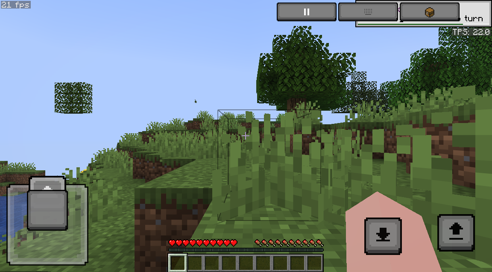

# Bedrock-style touch controls for Eaglercraft 26.2

A touch control layer for [Eaglercraft](https://eaglercraft.com/) 26.2, the browser port of
Minecraft. It gives the official single-file client a Bedrock Edition style HUD — left joystick,
jump and sneak buttons, drag to look, tap to interact, hold to break — drawn with Mojang's own
Bedrock control textures, so the pixels match the game.

- **Licence**: MIT (see [LICENSE](LICENSE) and [NOTICE](NOTICE))
- **Author**: [terry65536](https://github.com/terry65536)
- **Tested against**: the official single-file client `eaglercraft-26.2-8c167d43.html` (26.2 u2)



---

## Contents

- [Features](#features)
- [Requirements](#requirements)
- [Getting started](#getting-started)
- [Controls](#controls)
- [Configuration](#configuration)
- [How it works](#how-it-works)
- [Repository layout](#repository-layout)
- [Testing](#testing)
- [Licence and attribution](#licence-and-attribution)
- [Known limitations](#known-limitations)
- [Acknowledgements](#acknowledgements)
- [References](#references)

---

## Features

| | |
| --- | --- |
| The game binary is not patched | About 50 KB of JavaScript is injected into the client's `<head>`; the six embedded payloads (`classes.wasm`, `mesh-worker.wasm`, `server-worker.wasm`, `assets.epk`, `sounds.epk`, the Brotli decoder) can be verified byte for byte |
| Authentic artwork | Joystick frame and knob, arrows, jump, sneak and the wide buttons come from `Mojang/bedrock-samples`, drawn at integer scale with smoothing off |
| Classic layout | Jump button only, the way Bedrock's classic controls work: tap to interact, hold to break, double-tap the joystick forward to toggle sprint |
| Yields to menus | Opening any game screen (inventory, settings, pause) hides the layer and releases every held key; touches then go to the vanilla widgets, apart from one back plate that closes the screen again |
| Desktop untouched | Enabled only on coarse-pointer touch devices (`maxTouchPoints > 0` and `pointer: coarse`); the same file behaves exactly like stock Eaglercraft with mouse and keyboard |

---

## Requirements

- The official Eaglercraft 26.2 single-file client (not included; see below)
- A mobile browser that opens local files: tested in Android browsers over `file://`
- `localStorage` available to the page — the option seeding described below depends on it. Without
  it the layer stays hidden and the client's own touch controls keep working
- Node.js 18 or newer, only to build

---

## Getting started

1. Download the official single-file client from [eaglercraft.com](https://eaglercraft.com/).
2. Inject the layer:

   ```sh
   node touch/pack.mjs <official client.html> <output.html>
   ```

   The output is one `.html` that can be copied to a device as it is. Every byte of the client
   outside the injected block is left as it was, so the six embedded payloads can be compared
   against the official file with `cmp`.

3. Copy the resulting `.html` to the phone or tablet, open it as a local file, turn the device
   sideways and go fullscreen.

> `touch/sprites.js` is committed, so nothing has to be regenerated to build. To use your own
> artwork instead of Mojang's textures, drop same-named PNGs into `docs/sprites/` and run
> `node touch/mksprites.mjs`.

---

## Controls

| Gesture | Action | Client input |
| --- | --- | --- |
| Joystick | 8-way movement, including diagonals | `KeyW/A/S/D` combinations |
| Double-tap joystick forward | Toggle sprint (sticky) | `ControlLeft` |
| Hold the joystick fully forward | Temporary sprint | `ControlLeft` |
| Drag on empty area | Look around | synthetic `mousemove` (virtual cursor) |
| Tap on empty area | Interact / place / open crafting table, furnace, chest | right mouse button (`keyUse`) |
| Hold on empty area | Break a block or attack, release to stop | left mouse button held (`keyAttack`) |
| Jump button | Jump; double-tap to fly and land in Creative | `Space` |
| Sneak button | Tap toggles crouch, holding keeps it | `ShiftLeft` |
| Inventory chip | Open or close the inventory | `KeyE` |
| Chat chip | Open chat | `KeyT` |
| Pause chip | Pause menu | `Escape` |
| Hotbar | Tap a slot to select it | `Digit1`–`Digit9` |
| Back plate (top right, only over a menu) | Close the inventory, crafting table, furnace or chest | `Escape` |
| F9 | Force the layer on or off (writes `localStorage["_eaglerBedrock"]`, then reloads) | — |

Java Edition closes a container screen with `E` or `Escape` only — tapping the empty space around
the slots does nothing — so while a menu is open the layer leaves exactly one control on screen:
a Bedrock button plate in the corner where the pause chip normally sits. Everything else in the
menu is touched directly.

The client attaches its key listeners to `window`, and an event dispatched on `document` or the
canvas bubbles into that same listener, so a key is delivered **once**, on `window`, to avoid one
tap being read as several presses. With `Escape` that difference is visible: three deliveries
close the inventory and then open the pause menu again.

Thresholds: a press counts as a tap when it lasts at most 230 ms and moves less than 10 px, and as
a hold from 240 ms upwards.

---

## Configuration

Runtime knobs, no rebuild needed:

```js
window.__eagBedrock.cfg.lookSensitivity = 1.1;   // default 0.85
window.__eagBedrock.cfg.invertLookY = true;      // default false
window.__eagBedrock.cfg.tapMs = 230;             // tap ceiling
window.__eagBedrock.cfg.holdMs = 240;            // hold threshold
window.__eagBedrock.cfg.dragPx = 10;             // movement that counts as a drag
window.__eagBedrock.cfg.stickDeadZone = 0.24;
window.__eagBedrock.cfg.stickSprint = 0.92;      // how far forward counts as sprint
window.__eagBedrock.cfg.doubleTapMs = 520;
window.__eagBedrock.cfg.modePollMs = 120;
window.__eagBedrock.info();                      // { seeded, world, on, sprites }
window.__eagBedrock.layout();                    // hit areas at the current scale
```

Attribution is deliberately quiet: two small lines flash on the client's own loading screen for two
seconds (`Touch UI by terry65536` and the repository URL, `clamp(15px, 3.4vmin, 20px)`, ending with a
250 ms fade), and they are dropped immediately if the boot screen disappears sooner. Nothing is
placed inside the game, and there is no separate credits screen.

---

## How it works

Eaglercraft 26.2 is a Java client compiled to WebAssembly by TeaVM, so nothing in the game can be
called from JavaScript. The layer therefore only produces the DOM events and the client options
that the game already listens for.

### 1. Switching off the client's own touch HUD

`TouchControls26` draws a WASD plus JMP/SNK/ATK/USE overlay on touch devices. Its switch is a
persisted option, and options are stored as:

```
localStorage["_eaglercraftX.g"] = base64( gzip( options.txt text ) )
```

(see `PlatformApplication.getLocalStorage()` and `EagRuntime.getStorage("g")`). `touch/options.js`
writes or merges two lines before the game reads them:

```
eaglerTouchControls:false     # hide the vanilla touch HUD
eaglerRdpMouse:true           # enable remote-desktop mouse mode
```

With an existing store the text is decoded, these two keys are replaced and the result re-encoded,
leaving every other setting alone. Writing happens only on a touch device, or after the user
pressed F9.

### 2. Looking around without Pointer Lock

Pointer Lock is unavailable on phones, and the client deliberately skips it
(`PlatformInput.mouseSetGrabbed()` returns early when `isLikelyMobileBrowser` and touch controls
are enabled). In `rdpMouseMode` it derives rotation from absolute cursor positions instead:

```java
pointerLockFlag = grab;          // a logical flag; nothing is really locked
int dx = nextMouseX - mouseX;
mouseDX += dx; mouseDY += dy;
```

The layer keeps a virtual cursor and feeds finger movement into synthetic `mousemove` events, so
sensitivity and smoothing stay entirely the game's own logic.

That path is the only one the layer drives, and its cost is capped in two ways. The canvas box is
measured once per layout and cached (refreshed on resize, rotation and scroll), so a drag performs
no layout reads of its own. And finger samples are not forwarded as they arrive: a phone reports
touch at up to 120 Hz, while the game only consumes accumulated deltas once per frame, so movement
is queued and flushed from a single frame callback — at most one `mousemove` reaches the client per
animation frame, whatever the digitiser rate.

Two details of that branch decide whether a full turn is possible. `scaleCoordinate` clamps the
absolute position into the canvas, and any single step larger than `max(48, size/3)` is discarded,
so a virtual cursor that drifts off the canvas stops producing rotation and cannot be dragged back
either. The client's own answer is the modifier check in the same branch: while `altKey` is set it
re-tracks the cursor without looking. The layer therefore keeps the cursor inside the canvas and,
when a drag reaches the edge, sends one `altKey` move that folds it to the opposite edge before
spending that step from there. Nothing is lost and nothing is rejected, so dragging in one
direction turns without limit and dragging back returns the heading to where it started.

### 3. Telling menus from the world

The same `rdpMouseMode` branch writes a CSS property:

```java
canvas.getStyle().setProperty("cursor", grab ? "none" : "default");
```

Reading it distinguishes world from menu without touching the framebuffer: `getComputedStyle`,
`readPixels` and screenshot comparisons all stay out of the running game.

When that property never appears — `localStorage` blocked, or a browser without
`CompressionStream` — the seeding did not take either, so the client still draws its own touch HUD
and keeps handling touches itself. The layer then stays hidden instead of guessing the mode from
pixels. Reading the crosshair back would mean sampling inside the client's own frame callback,
because the game renders with WebGL2 and `preserveDrawingBuffer:false` (anything drawn later returns
pure black), and a GPU sync on a timer is exactly the cost a low-end phone cannot spare. A device
that refused the option store is better served by the vanilla controls than by a second guess.

### 4. Rendering

One overlay `<canvas>`. Textures are blitted at integer scale, and the scale factor is recomputed
with the same AUTO rule as `Window.calculateScale` (`fb/(s+1) >= 320 && >= 240`), so the hit areas
track the game's GUI size at any setting.

Three things keep the overlay off the game's frame budget:

- nothing is drawn unless something changed, and the change is coalesced to one repaint per frame;
- a repaint clears only the joystick, the jump/sneak cluster and the chip strip instead of the whole
  device-resolution canvas;
- the frame callback is scheduled per change rather than chained, so an untouched screen runs no
  JavaScript from this layer at all.

---

## Repository layout

```
touch/
  options.js        writes eaglerTouchControls / eaglerRdpMouse into localStorage
  sprites.js        Bedrock control textures, inlined as data URLs
  bridge.js         event synthesiser: key, mouse, touch, wheel, hit areas
  overlay.js        the layer itself: layout, drawing, gesture state machine, mode detection
  credits.js        the two lines on the loading screen
  pack.mjs          builds the deliverable from the official client
  mksprites.mjs     regenerates sprites.js from docs/sprites/
  test_helpers.js   measurement helpers; never packed into the deliverable
  stub.html         minimal page for driving the layer without the game
docs/               control textures and a screenshot
LICENSE  NOTICE  README.md
```

---

## Testing

Everything runs in headless Chromium over the DevTools Protocol, with real trusted touch events
(`Input.dispatchTouchEvent`) rather than synthetic DOM events.

| Suite | What it asserts | Result |
| --- | --- | --- |
| Gesture state machine (`touch/stub.html`) | Every key, mouse and touch call the layer emits: 8-way joystick, monotonic look deltas, tap/hold boundary, jump, sneak, hotbar, inventory, double-tap sprint, keys released when a screen opens | 14 / 14 |
| Device gating | Enabled and seeded on a touch device; on desktop the layer stays off and the client's own options are untouched | 7 / 7 |
| Back plate | Hidden on the title screen and in world, sits exactly on the pause chip's rect over a menu, emits one `Escape` press and release and nothing else, locks itself out for 700 ms after a tap so a second tap cannot open the pause menu instead, comes back if the screen is still open, and follows the layout on rotation | 11 / 11 |
| Full rotation | Replays every emitted `mousemove` through the client's own rule — coordinates clamped into the canvas, steps over `max(48, size/3)` discarded, look suspended while Alt is held — and checks a long spin keeps turning, stays inside the canvas, and returns to the same heading when spun back | 7 / 7 |
| Per-second cost | Counts, over a scripted drag: `getBoundingClientRect` calls, `mousemove` events reaching the client per animation frame, canvas pixels cleared per repaint, and JavaScript running on an untouched screen; also compares the alpha coverage of the joystick box before, during and after a push to prove a partial clear leaves no residue | see below |
| End-to-end | Walks the real menus to generate a world, then checks the HUD, drag-to-look, joystick walking and hold-to-break against screenshot pixel differences, each beside a no-input control run of equal length | re-run on request |
| Container integrity | The six payloads of a built file compared byte for byte with the official client | identical |

Measured on a 980×620 viewport at `devicePixelRatio` 3, so the overlay canvas is 2940×1860:

| | 40-sample stick drag | 40-sample look drag | idle |
| --- | --- | --- | --- |
| layout reads by the layer | 0 | 0 | 0 |
| `mousemove` into the client | 0 | 41, at most one per frame | 0 |
| canvas cleared per repaint | 3 small boxes (was the full canvas) | 3 small boxes | nothing |
| repaints | one per frame while the knob moves | 1 | 1 |

Frame comparisons decode CDP screenshots rather than reading the page's canvas, because the client
renders with WebGL2 and `preserveDrawingBuffer:false` — see [How it works §3](#3-telling-menus-from-the-world).

---

## Licence and attribution

The touch layer (`touch/*.js`) is MIT licensed, Copyright (c) 2026
[terry65536](https://github.com/terry65536). That licence covers this repository's own code only.
The deliverable combines works under different terms; full text and caveats are in
[NOTICE](NOTICE).

| Component | Author / source | Terms |
| --- | --- | --- |
| Touch layer | terry65536 | MIT (this repository) |
| Eaglercraft 26.2 u2 client sources | `o_xer`, `kingjoeishere` (26.2 workspace); `lax1dude`, `ayunami2000` (the Eaglercraft / EaglercraftX engine it descends from) | the upstream repository ships no LICENSE file; source headers carry a BSD 2-Clause style disclaimer stamped `Copyright (c) 2022-2026 lax1dude / Eagler 26.2` |
| Minecraft code and assets | Mojang Synergies AB / Microsoft | proprietary, under the [Minecraft EULA](https://www.minecraft.net/en-us/article/minecraft-eula) |
| Bedrock control textures (`docs/`, `sprites.js`) | Mojang [`bedrock-samples`](https://github.com/Mojang/bedrock-samples) | no LICENSE file in that repository; the textures remain Mojang's intellectual property and can be replaced with original artwork through `mksprites.mjs` |
| TeaVM (Java → WebAssembly compiler) | Vicentiu Troianovskyi | Apache-2.0 |
| `brotli-dec-wasm` | brotli / wasm-bindgen ecosystem | MIT / Apache-2.0 |
| Official single-file client | Eagler project, from [eaglercraft.com](https://eaglercraft.com/) | not distributed here; `pack.mjs` takes it as user-supplied input |

---

## Known limitations

- **Input method**: turning off the vanilla touch HUD also removes its zone for raising the soft
  keyboard, so tapping the chat chip may not open an IME on some Android browsers.
- **Multiplayer**: 26.2's LAN and remote play depend on a public WebSocket relay for signalling.
  None of the relays baked into the client were reachable while testing, and a browser page can
  neither listen on a port nor act as the server.
- **Music**: the official lean build ships without background music; it lives in a separate
  resource pack.
- **Mode latency**: menu/world detection polls every 120 ms (`cfg.modePollMs`), so the HUD can lag
  by a frame interval when a screen opens.
- **No storage, no layer**: if the page cannot write its options (`localStorage` blocked by the
  browser or by a private mode), the layer hides itself and leaves the device to the client's own
  touch HUD. The look path needs `eaglerRdpMouse`, and that option needs the store.

---

## Acknowledgements

- `lax1dude`, `ayunami2000` — the original Eaglercraft and EaglercraftX projects
- `o_xer` (eymenwsmc), `kingjoeishere` (Joey-JM) — the Eaglercraft 26.2 / 26.2 u2 ports
- Mojang Synergies AB / Microsoft — Minecraft and the `bedrock-samples` control textures
- Vicentiu Troianovskyi — TeaVM
- Everyone who has contributed mirrors, translations and documentation to the Eaglercraft community

---

## References

- Eaglercraft downloads — <https://eaglercraft.com/>
- Eaglercraft 26.2 u2 workspace — <https://github.com/kingjoeishere/Eaglercraft-26.2-u2-workspace>
- Option storage: `platform-teavm/.../PlatformApplication.java` (`getLocalStorage`), `game/.../Options.java` (`eaglerTouchControls`, `eaglerRdpMouse`)
- Touch and look interface: `game/.../touch_gui/TouchControls26.java`, `game/.../MouseHandler.java` (`eaglerTouchLookDelta`, `eaglerTouchPointer`)
- GUI scaling: `com/mojang/blaze3d/platform/Window.java#calculateScale`
- Bedrock control textures — <https://github.com/Mojang/bedrock-samples> (`resource_pack/textures/gui/controls/*`, `resource_pack/textures/ui/*`)
- Minecraft EULA — <https://www.minecraft.net/en-us/article/minecraft-eula>
- TeaVM — <https://teavm.org/>
- Single-file packaging: `wasm-toolchain/build-single-html.js` (the `eag-inline-*` payload container)
